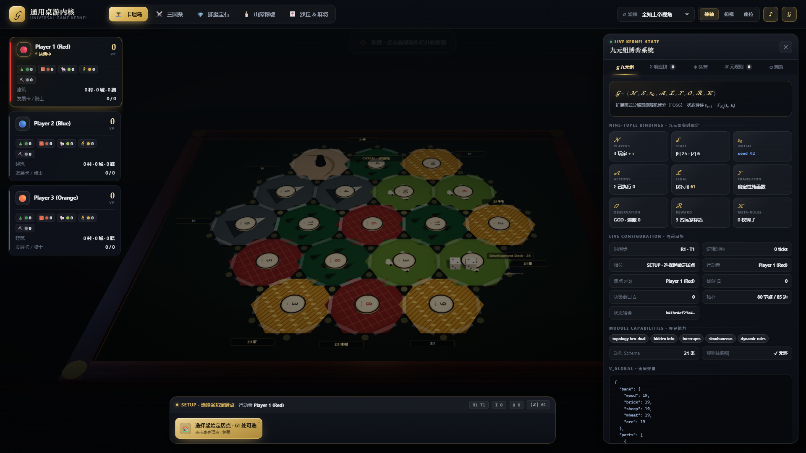
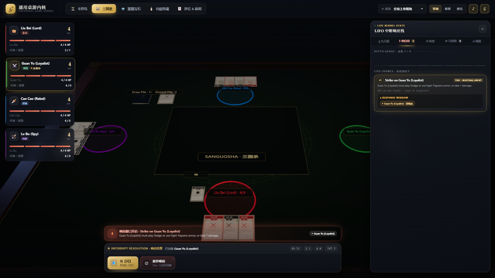
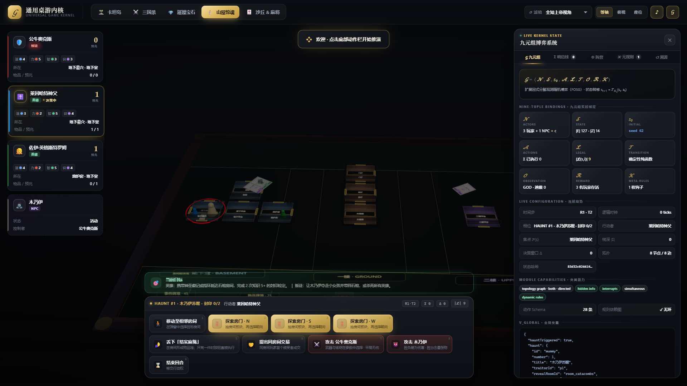
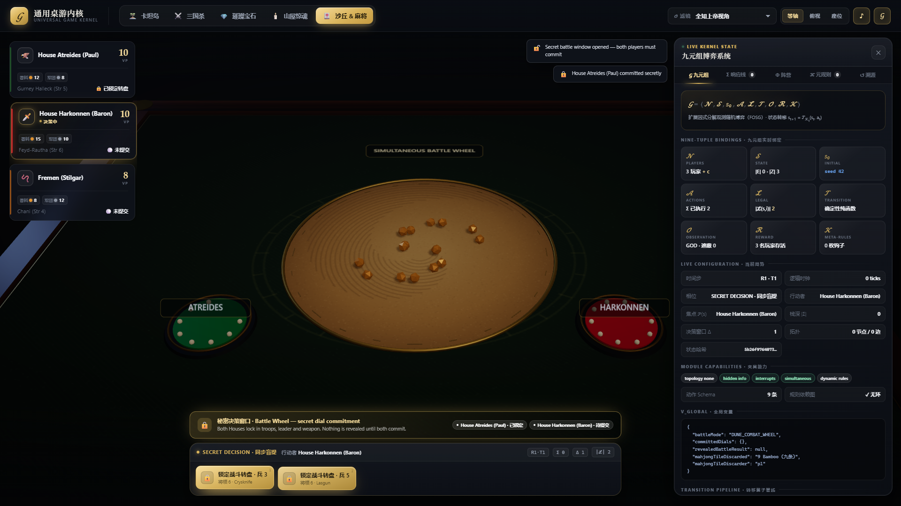
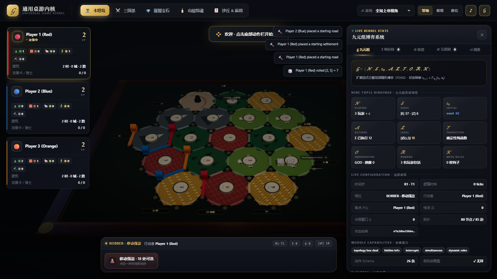
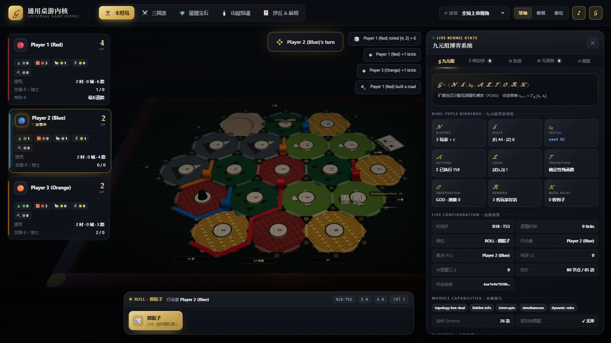
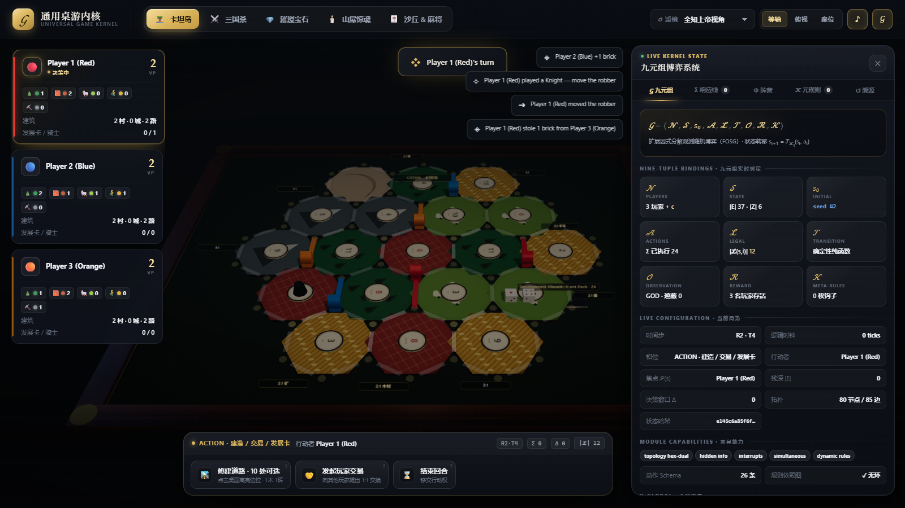
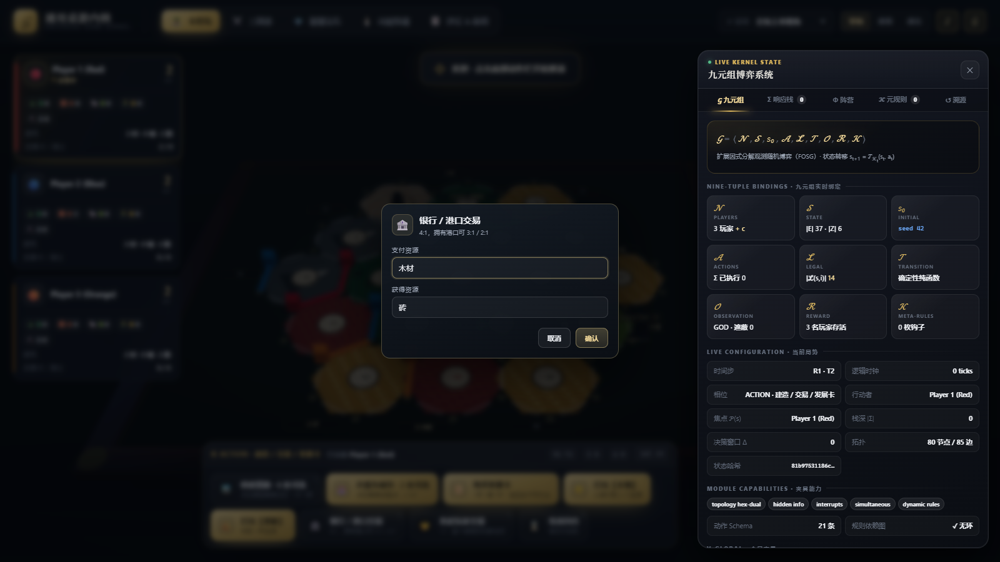

# 通用桌游内核 · Universal Board Game Kernel

> 产品是**内核框架**，不是某一款桌游。
> `src/games/*` 下的五款游戏只是**一致性测试夹具**，用来证明内核可以覆盖顺序回合、递归响应、隐藏信息、同步盲提与运行时改规则。

```
𝒢 = ⟨𝒩, 𝒮, s₀, 𝒜, ℒ, 𝒯, 𝒪, ℛ, 𝒦⟩
```

内核把任意桌面博弈编译为：**纯 JSON 状态 + 纯函数转移 + 可热插拔规则 + 信息投影 + 事件溯源**。浏览器端（Three.js + HUD）是这套内核的可视化调试器。



---

## 1. 快速开始

```bash
pnpm install
pnpm run dev       # http://127.0.0.1:5173/  （可视化调试器）
# 场景直达：http://127.0.0.1:5173/?scenario=rich_action
pnpm test          # 126 项用例 + UI/内核边界检查
pnpm run build     # 生产构建
```

内核本身可在 Node 中通过 Vite SSR 直接加载（见 `scripts/test-core.mjs`），不依赖浏览器。

---

## 2. 这个内核解决什么问题

| 能力 | 机制 | 代码 |
| --- | --- | --- |
| 确定性状态转移 | `dispatch` 单一管线 + 纯函数 reduce | [engine.ts](src/core/engine.ts) |
| 隐藏信息与反作弊 | `𝒪(s,i)` 投影、虚拟 ID、区域重映射、模块级 redactor | [observer.ts](src/core/observer.ts) |
| 递归响应链 | LIFO 中断栈、响应窗口、优先级短路 | [stack.ts](src/core/stack.ts) |
| 同步/秘密决策 | 决策窗口、秘密提交、原子揭晓 | [decisions.ts](src/core/decisions.ts) |
| 运行时改规则 | 规则以数据挂载，实现从注册表解析 | [aop.ts](src/core/aop.ts) · [rules.ts](src/core/rules.ts) |
| 状态可持久化 | 状态内禁止函数；规则实现不在状态里 | [types.ts](src/core/types.ts) |
| 结构正确性 | 30+ 条不变量，转移后校验 | [invariants.ts](src/core/invariants.ts) |
| 回溯与时间机器 | 规范化 JSON + FNV-1a 哈希 + 完整动作历史 | [serialize.ts](src/core/serialize.ts) |
| 扩展契约 | `GameModule` 接口 + 能力矩阵 | [module.ts](src/core/module.ts) |
| 动作结构校验 | 模块声明 `actionSchemas`，合法性之前校验 | [validation.ts](src/core/validation.ts) |
| 规则依赖图 | `requires` 声明、环检测、依赖优先执行 | [rules.ts](src/core/rules.ts) |
| AI 接口 | `BotPolicy` + 随机策略 + 批量对局 | [policy.ts](src/ai/policy.ts) |
| 网络适配层 | 权威房间 + 投影增量补丁 | [room.ts](src/net/room.ts) · [patch.ts](src/net/patch.ts) |
| UI 解耦 | Presenter + DTO + PresentationPorts | [contracts.ts](src/app/contracts.ts) · [session.ts](src/app/session.ts) |
| 决策策略 | ALL_COMMITTED / FIRST_ACCEPT / PRIORITY，首个接受短路 | [decisions.ts](src/core/decisions.ts) |
| 玩家级超时 | 每个参与者独立 deadline，逐人 PASS | [engine.ts](src/core/engine.ts) |
| 可重放场景 | module.scenarios + 导出日志携带 scenario | [module.ts](src/core/module.ts) |
| 参数表单 | Action.fields → UI 表单 → payload，一步完成 | [contracts.ts](src/app/contracts.ts) · [hud.ts](src/ui/hud.ts) |
| 逻辑时钟与超时 | `__TICK__` 控制动作、decision/response deadline、可重放超时 | [engine.ts](src/core/engine.ts) |
| 检查点持久化 | 种子 + Action Log 导出、重放式恢复 | [room.ts](src/net/room.ts) |

规则手册级的契约见 **[docs/CORE.md](docs/CORE.md)**；当前分层、模块实现与调用链见 **[docs/ARCHITECTURE.md](docs/ARCHITECTURE.md)**；山屋的规则覆盖与模拟器缺陷评估见 **[docs/BETRAYAL.md](docs/BETRAYAL.md)**；内核表达缺陷的改造 RFC 见 **[docs/KERNEL-EXPRESSION.md](docs/KERNEL-EXPRESSION.md)**；持续维护的模拟器质量清单见 **[docs/SIMULATOR-AUDIT.md](docs/SIMULATOR-AUDIT.md)**；已确认边界与后续可选开发见 **[docs/BACKLOG.md](docs/BACKLOG.md)**。

---

## 3. 核心管线

`engine.dispatch(action)`：

```
validate → 决策窗口 Δ → 响应窗口 Σ → AOP(𝒦) → reduce(𝒯) → outcome(ℛ)
        → invariants → hash → actionLog → visual events
```

- **拒绝路径不改变状态**；
- **被规则取消的动作不递增 `seq`、不写日志**，因此回放严格对齐；
- 回放不是“再 reduce 一次”，而是用完全相同的 `dispatch` 管线重新推演（含决策、栈与钩子）。

状态只保存规则**数据**：

```ts
activeHooks: [{ instanceId, hookId: 'haunt_crimson_beast', ownerId, params: { bonusMight: 2 } }]
```

实现位于模块的 `hooks` / `RuleRegistry`，因此 `GameState` 永远可以 `JSON.stringify`、哈希与跨进程传输。钩子可用 `requires` 声明前置依赖，注册表会做环检测并按依赖顺序执行。

动作在进入合法性判断前先过 `actionSchemas`（必填/枚举/范围），防止畸形提交进入秘密决策窗口。

---

## 4. 五款夹具验证的能力

| 夹具 | 验证点 |
| --- | --- |
| Catan | 蛇形初始布局、9 港口 3:1/2:1、有限银行、19 地形 + 18 数字、25 发展卡、7 点弃牌/强盗/偷取、最长道路/最大军队、隐藏 VP、10 分胜利 |
| Sanguosha | 递归中断栈（杀→闪/八卦→濒死→无懈）、暗置身份、AOP 拦截 |
| Splendor | 近似完全信息、永久费用修饰器、自动结算 |
| Betrayal | 44 房间、四维轨道、13 预兆/25 物品/45 事件、NPC 怪物与三剧本 |
| Dune / Mahjong | 秘密同步决策 `|P(s)|>1`、优先级仲裁与短路 |

| 三国杀响应栈 | 山屋三剧本 | 沙丘秘密决策 |
| --- | --- | --- |
|  |  |  |

| Catan 初始布局 | Catan 建造与最长道路 | Catan 发展卡 |
| --- | --- | --- |
|  |  |  |

| 参数表单（银行交易） |
| --- |
|  |

> 夹具只实现 `setup / legalActions / reduce / outcome`。调度、隐藏、中断、热注入、回放全部由内核负责。

### Catan 规则覆盖

- 19 张地形（4 木 / 4 羊 / 4 麦 / 3 砖 / 3 矿 / 1 沙漠）、18 个数字片、9 个港口（5 个 2:1 + 4 个 3:1）；
- 蛇形初始布局 `p1→p2→p3→p3→p2→p1`：定居点 + 道路，距离规则、第二座定居点获得初始资源；
- 有限银行（每种 19 张），生产受银行库存与强盗阻挡；
- 7 点：>7 张者弃半、移动强盗、按相邻建筑偷取 1 张；
- 建筑：道路 / 定居点 / 城市 / 发展卡，费用与 VP 完全按规则；
- 25 张发展卡：14 骑士、2 垄断、2 修路、2 丰饶、5 分数卡；购买当回合不可打出；
- 最长道路（≥5，对手建筑阻断）与最大军队（≥3 骑士）各 2 VP，平局保持原持有者；
- 玩家交易走 FIRST_ACCEPT 决策窗口（1:1），银行/港口交易支持 4:1 / 3:1 / 2:1；两者都是单动作 + 参数表单；
- 10 分胜利；分数卡（VP）对对手隐藏，游戏结束时揭晓；
- 简化：弃半自动按“最大堆优先”执行；玩家交易固定 1:1；发展卡仅在 ACTION 阶段打出（官方允许掷骰前）。

---

## 5. 分层与边界

```
main.ts (装配根)
   │
   ▼
src/app/UniversalSession  ──GamePresenter(DTO)──▶  src/ui/hud.ts, mathInspector.ts
   │  owns engine                                      │
   ▼                                                   ▼
src/core/UniversalGameEngine                   PresentationPorts
                                                   │ camera / audio / highlight
                                                   ▼
                                             src/render (Three.js)
```

- UI **只** import `src/app/contracts`，不 import 引擎、游戏模块、Three.js、音频；
- 应用层负责动作标签、玩家卡片、阶段文案、已脱敏日志与重放结果；
- 相机 / 音效 / 桌面高亮经 `PresentationPorts` 回传；
- `pnpm test` 内置静态边界检查：UI 引用 core/games/render/net/ai 即失败。

---

## 6. 一致性测试

```bash
pnpm test
```

```
Universal Board Game Kernel — conformance suite
  ✓ serialize: canonical order + hashing is stable
  ✓ prng: same seed yields identical streams and shuffles
  ✓ ecs: moving entities preserves single ownership
  ✓ stack: LIFO order, response collection and priority short-circuit
  ✓ aop: stage/priority ordering, modify, cancel, after-trigger
  ✓ decisions: secret submissions stay hidden until reveal
  ✓ decisions: priority policy short-circuits and orders submissions
  ✓ observer: hidden cards are scrubbed, aliased and zone-remapped
  ✓ invariants: valid state passes, corrupted states are rejected
  ✓ engine: illegal actions are rejected without mutating state
  ✓ engine: deterministic replay reproduces the exact state hash
  ✓ engine: time machine rewinds and replays forward
  ✓ validation: schemas reject malformed actions before legality
  ✓ rule graph: missing dependencies and cycles are rejected
  ✓ fixture */initialises under strict invariants        (×5)
  ✓ fixture */random play + bit-exact replay             (×5)
  ✓ fixture */projections never leak hidden card faces   (×5)
  ✓ fixture dune_mahjong: secret simultaneous decision resolves atomically
  ✓ fixture sanguosha: interrupt stack resolves through hidden information
  ✓ fixture betrayal: haunt hot-injects a data-only rule hook
  ✓ fixture catan: snake setup, distance rule and phase gating
  ✓ fixture catan: rolling 7 opens robber flow and replay stays exact
  ✓ fixture catan: build costs, dev cards and bank conservation
  ✓ fixture catan: player trade, bank trade, bonuses and victory
  ✓ fixture catan: black-box random play never stalls or corrupts state
  ✓ fixture catan: forced seven discards half and resolves through the window
  ✓ fixture catan: harbours change bank trade ratios
  ✓ fixture catan: hidden VP cards are redacted from opponents
  ✓ bots: random policies play every fixture without kernel errors
  ✓ bots: identical seeds produce identical games
  ✓ room: projection patches round-trip exactly
  ✓ room: hidden information never appears in patches
  ✓ room: secret decision submissions are collapsed in deltas
  ✓ decisions: FIRST_ACCEPT resolves on the first acceptance only
  ✓ decisions: FIRST_ACCEPT resolves after all rejections
  ✓ engine: named scenarios replay through export/load
  ✓ engine: per-participant deadlines expire independently
  ✓ presenter: payload fields collapse multi-step choices into one action
  ✓ room: checkpoints restore through replay
  ✓ projection: module redactors hide secret roles and private globals
  ✓ engine: logical clock times out secret decisions deterministically
  ✓ engine: response windows time out and resolve the frame payload
  ✓ presenter: clock control advances the logical clock and expires decisions
  ✓ presenter: snapshot exposes actions and performs by id
  ✓ presenter: board picks are resolved to legal actions
  ✓ presenter: viewer switching reprojects without exposing the raw engine
  ✓ presenter: notices are emitted for kernel visual events

  126 passed, 0 failed · 0 boundary violations
```

---

## 7. 目录

```
src/core/                 # 内核（与具体游戏无关）
  engine.ts               # 调度、校验、回放、哈希
  module.ts               # GameModule 契约 + 能力矩阵
  types.ts                # 状态/动作/栈帧/决策窗口/规则钩子
  rules.ts                # RuleHookImpl + RuleRegistry + 依赖图
  aop.ts                  # FILTER_MODIFY / BEFORE_REPLACE / AFTER_TRIGGER
  stack.ts                # LIFO 中断栈
  decisions.ts            # 秘密/同步决策
  observer.ts             # 𝒪(s,i) 投影、反作弊、日志脱敏
  invariants.ts           # 结构不变量
  serialize.ts            # 规范化 JSON + FNV-1a
  validation.ts           # 动作 Schema 校验
  ecs.ts / graph.ts / prng.ts
  testing/suite.ts        # 一致性测试
src/app/                  # 应用层：Presenter 契约 + Session + DTO
src/ai/policy.ts          # Bot 接口与随机策略
src/net/                  # 权威房间 + RFC6902 投影差分
src/games/                # 五款夹具（setup + rules + hooks）
src/render/               # Three.js 可视化调试器
src/ui/                   # HUD 与数学模型检查器
docs/CORE.md              # 契约、扩展指南、路线图
docs/ARCHITECTURE.md      # 分层架构、模块实现与调用链
docs/BETRAYAL.md          # 山屋 44 房间/三剧本覆盖 + 内核缺陷清单
docs/KERNEL-EXPRESSION.md # 内核表达缺陷分析与分波次改造 RFC
scripts/test-core.mjs     # Vite SSR 测试运行器
```

---

## 8. 设计取舍

- **不做“万能规则 DSL”**：规则仍是 TypeScript 纯函数，但所有横切能力（调度/隐藏/栈/热注入/回放）被内核收口，避免每款游戏重复实现。
- **规则实现与状态分离**：这是可序列化、可回放、可联网的前提。
- **严格模式**：非法动作与不变量违例默认拒绝并保持状态不变，便于夹具开发时立刻暴露问题。
- **夹具优先**：先让五种极端机制跑通，再抽象；不为单一游戏做特例。
